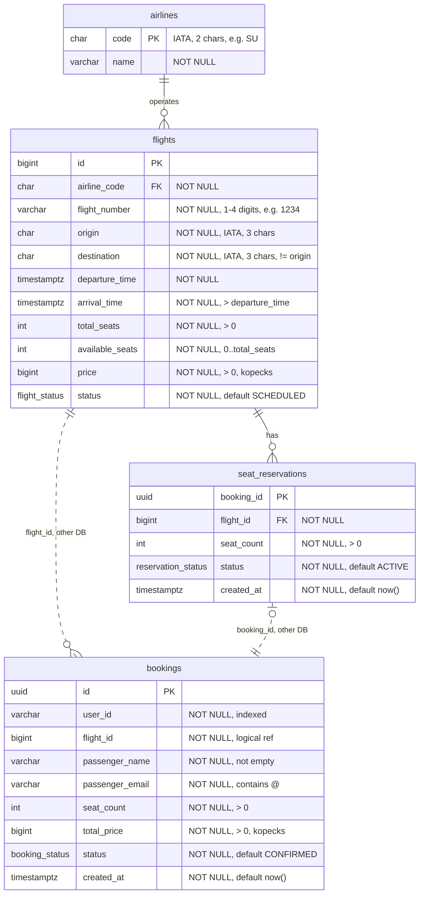

# ER-диаграмма

Две независимые базы: `flight_db` (Flight Service) и `booking_db` (Booking Service).
Пунктирная связь `flights → bookings` логическая: базы разные, поэтому
внешнего ключа нет, `bookings.flight_id` проверяется через `GetFlight`.

## Ограничения целостности

**flight_db**

- `flight_status`: `SCHEDULED`, `DEPARTED`, `CANCELLED`, `COMPLETED`.
- `reservation_status`: `ACTIVE`, `RELEASED`, `EXPIRED`.
- `flights`: уникален `(airline_code, flight_number, дата вылета в UTC)`.
  Один номер рейса в один день — это один рейс.
- `flights`: `total_seats > 0`, `price > 0`,
  `0 <= available_seats <= total_seats`, `arrival_time > departure_time`,
  `origin <> destination`, IATA-коды — заглавные латинские буквы.
- `seat_reservations.booking_id` — первичный ключ, поэтому одному бронированию
  соответствует ровно одна резервация. На этом же держится идемпотентность
  `ReserveSeats`.

**booking_db**

- `booking_status`: `CONFIRMED`, `CANCELLED`.
- `bookings`: `seat_count > 0`, `total_price > 0`.
- Индекс по `user_id` для `GET /bookings?user_id=X`.

## Нормализация (3NF)

- Название авиакомпании вынесено в `airlines`. Код `SU` однозначно определяет
  `Aeroflot`, и при хранении названия в `flights` оно повторялось бы
  в каждом рейсе. Пользователю номер рейса отдаётся целиком:
  `airline_code || flight_number` = `SU1234`.
- Аэропорты хранятся кодом без отдельной таблицы: других атрибутов
  у аэропорта в системе нет, дублировать нечего.
- `bookings.total_price` — не производное от цены рейса, а цена, зафиксированная
  на момент бронирования. Последующее изменение цены рейса её не меняет.
- `flights.available_seats` можно вычислить как
  `total_seats - SUM(seat_count)` по активным резервациям. Колонка хранится
  по требованию задания: резервирование атомарно уменьшает её под
  `SELECT ... FOR UPDATE`, и согласованность обеспечивает транзакция.
