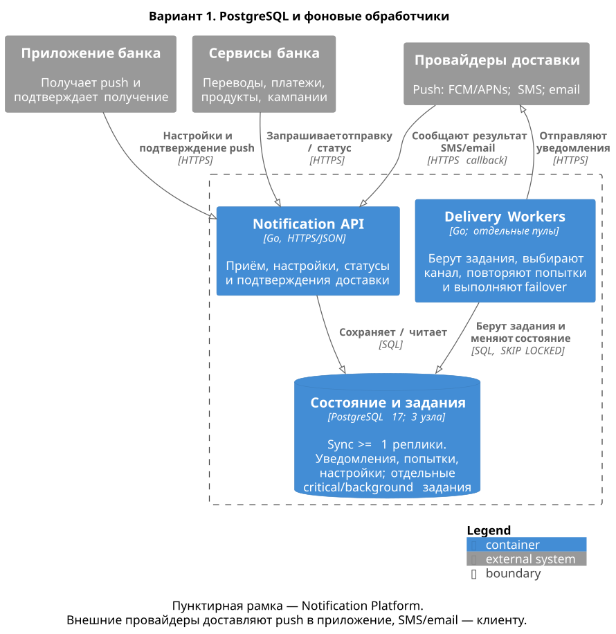
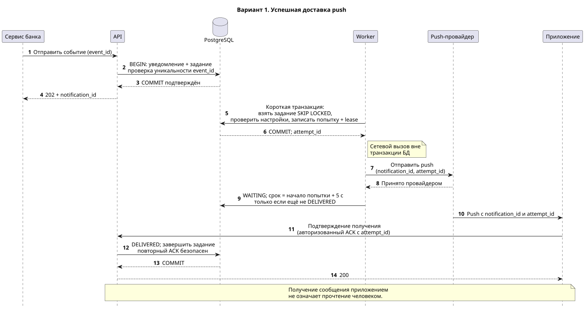
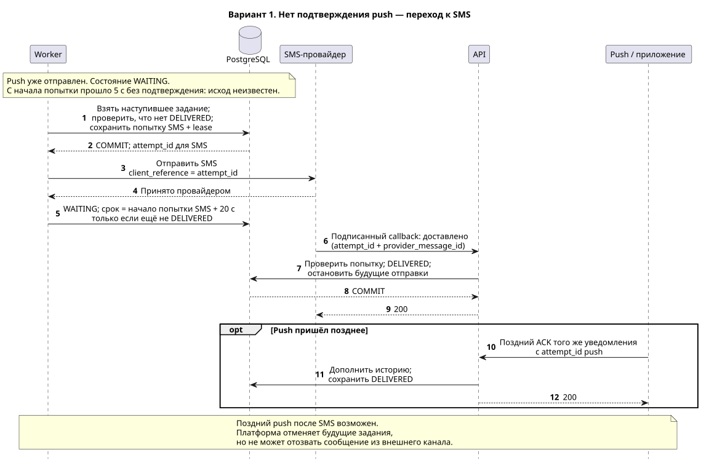
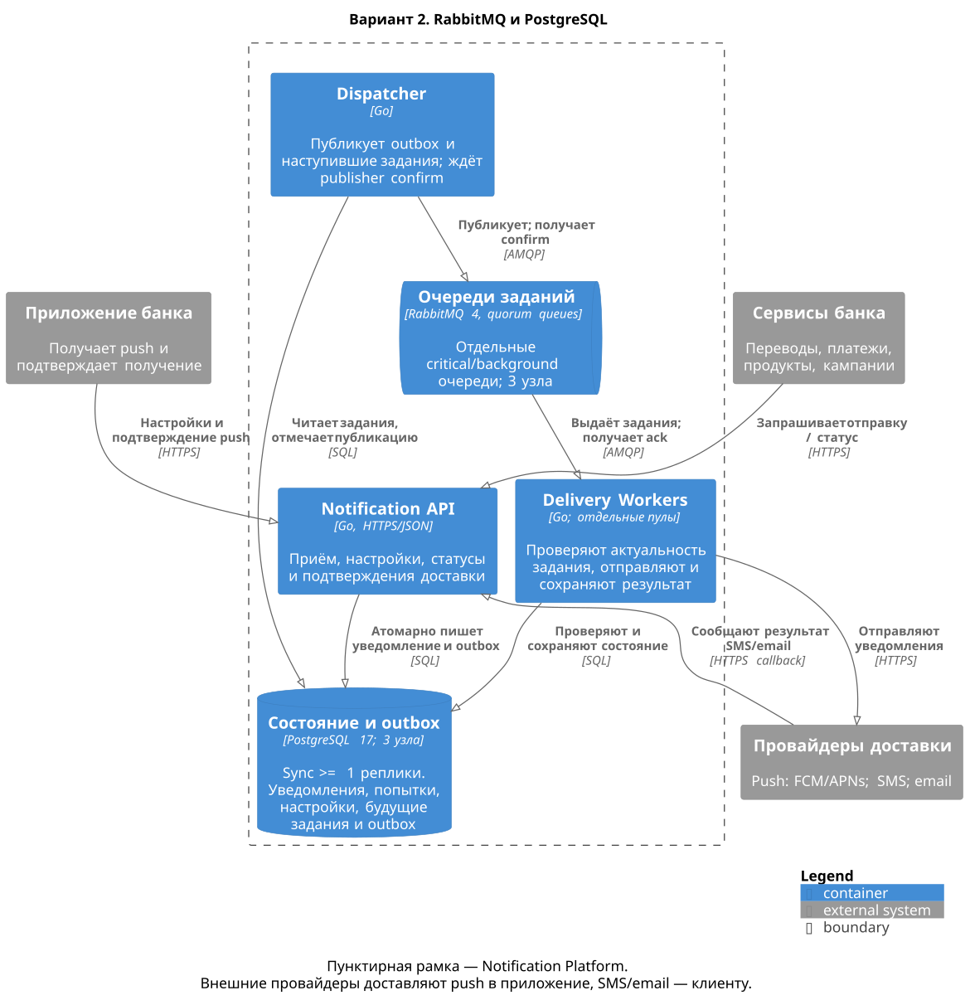
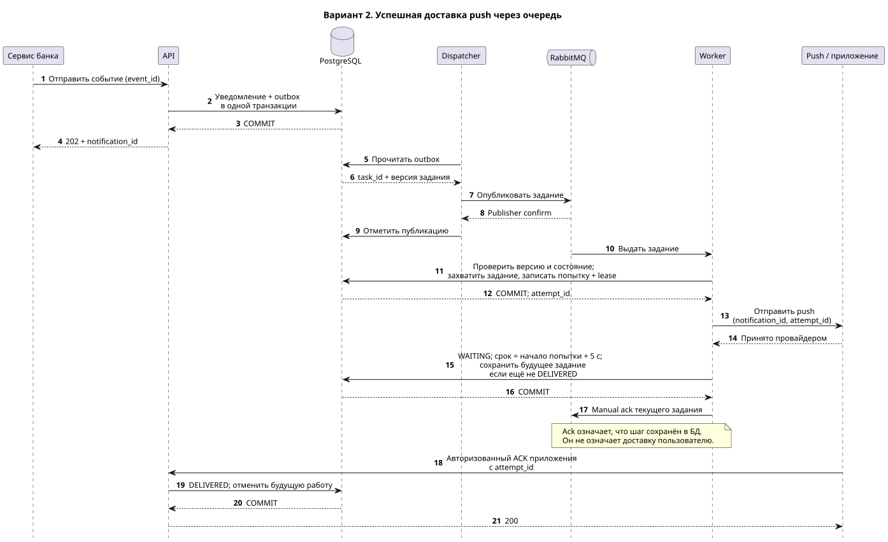
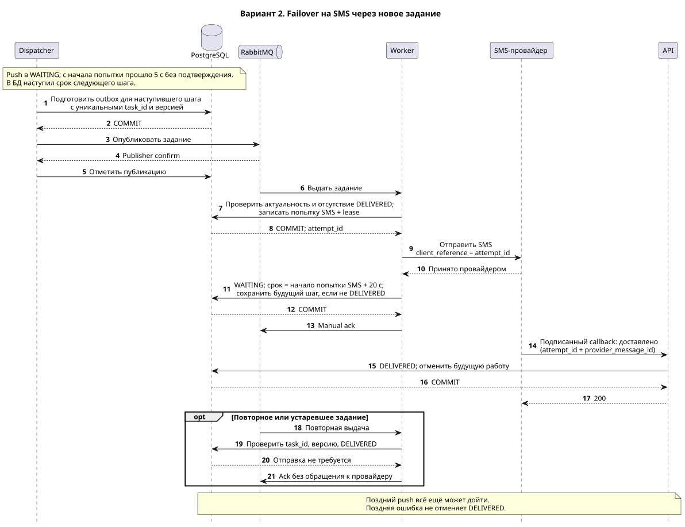

# RFC: доставка критичных уведомлений с переключением каналов

| Метаданные | Значение |
|---|---|
| Статус | DESIGN — учебный проект, эксплуатационные показатели ещё не измерены |
| Автор | Игорь Коломиец |
| Ответственный | Игорь Коломиец |
| Бизнес-заказчик | Команда онлайн-банка, условная роль в задании |
| Ревьюеры | Формальное ревью не назначено |
| Дата создания | 2026-11-15 |
| Дата обновления | 2026-11-15 |

Требования ко всей платформе и ответы на пункты 1–7 находятся в [REQUIREMENTS.md](REQUIREMENTS.md).

## Оглавление

1. [Контекст](#контекст)
2. [Продуктовый анализ](#продуктовый-анализ)
3. [Пользовательские сценарии](#пользовательские-сценарии)
4. [Статистика](#статистика)
5. [Требования](#требования)
6. [Варианты решения](#варианты-решения)
7. [Сравнительный анализ](#сравнительный-анализ)
8. [Выводы](#выводы)
9. [Связанные задачи](#связанные-задачи)
10. [Приложения](#приложения)

## Контекст

Сейчас команды банка отправляют уведомления самостоятельно. Поэтому нет общего статуса, одинаковой политики повторов и единого способа переключиться с неработающего канала. Клиент может не узнать о списании либо получить несколько одинаковых сообщений.

Предлагается Notification Platform: сервис банка один раз сообщает о событии, а платформа сохраняет запрос, выбирает канал и управляет доставкой. Этот RFC подробно описывает **критичные транзакционные уведомления**. Сервисные сообщения и маркетинг используют ту же платформу, но обрабатываются с меньшим приоритетом.

В проект входят приём, настройки, доставка, повторы, переключение каналов, статусы и наблюдаемость. Банковские операции, построение рекламных сегментов и внутренняя работа внешних провайдеров находятся за его границами.

**Главный выбор:** начать с PostgreSQL и фоновых обработчиков. Вариант с RabbitMQ рассмотрен как полноценная альтернатива. Оба варианта используют одну и ту же политику доставки.

## Продуктовый анализ

| Проблема | Изменение для пользователя или банка | Как измеряем эффект |
|---|---|---|
| Задержанные или потерянные сообщения о деньгах. | Резервный канал и видимый результат доставки. | Доля критичных уведомлений с подтверждением за 60 с; число недоставленных. |
| Повторы и нежелательная реклама. | Защита от повторных запросов и актуальные настройки. | Жалобы на 1000 доставленных уведомлений; доля отзывов согласия. |
| Разные решения команд, нет общей поддержки. | Единый статус и история попыток. | Доля обращений, для которых оператор смог установить причину по истории. |
| Избыточные расходы на SMS. | Push по умолчанию, платный резерв при необходимости. | SMS на одно критичное уведомление и стоимость успешной доставки. |

Бизнес-цели из задания уточняются следующим образом:

- **Retention +15%:** относительный рост D30 retention — доли пользователей когорты, вернувшихся на 30-й день. Например, 40% → 46%, а не 55%. Сравниваем сопоставимые когорты; изменение релевантности маркетинга проверяем экспериментом. Критичную доставку получают обе группы.
- **Жалобы −30%:** относительное снижение числа жалоб на 1000 доставленных уведомлений относительно четырёх недель до внедрения. Дополнительно смотрим абсолютное число жалоб, чтобы рост рассылок не скрывал проблему.
- **Доставка критичных сообщений:** NFR2, с разбором каждого случая без подтверждения.

Архитектура создаёт возможность улучшить эти показатели, но сама по себе не доказывает рост retention. Нужны наблюдения после запуска. Достаточный результат технического этапа — соблюдение SLO и отсутствие необъяснённых потерь.

## Пользовательские сценарии

| Приоритет | Тип сценария | Действующее лицо | Сценарий |
|---|---|---|---|
| MUST HAVE | Основной | Сервис переводов и клиент | После перевода сервис создаёт уведомление. Клиент получает push, приложение подтверждает получение. Платформа фиксирует доставку. |
| MUST HAVE | Резервный | Клиент | Push не подтверждён за 5 с. Платформа отправляет SMS, получает подтверждение и прекращает новые отправки. |
| MUST HAVE | Повтор запроса | Сервис переводов | Ответ API потерялся. Сервис повторяет запрос с тем же ключом и получает тот же идентификатор уведомления. |
| MUST HAVE | Настройки | Клиент | Клиент выбирает предпочтительный канал и отключает рекламу. Новые отправки учитывают изменение; уже переданное провайдеру сообщение может прийти. |
| MUST HAVE | Полный отказ | Оператор | Подтверждения нет спустя 60 с. Оператор видит проблему, автоматические попытки продолжаются по ограниченной политике. После исправления контакта оператор может возобновить доставку. |
| MUST HAVE | Массовая кампания | Маркетолог | Задаёт готовую аудиторию до 1 млн пользователей. Платформа отправляет только согласившимся, показывает прогресс и сохраняет приоритет критичных сообщений. |
| SHOULD HAVE | Анализ расходов | Продуктовая команда | Сравнивает стоимость и успешность каналов, затем меняет политику после проверки влияния на доставку. |

## Статистика

В условии даны 10 млн MAU, 3 млн DAU и 300 тыс. одновременно активных пользователей. Это исходные данные, а не результаты измерения нашей системы.

**Допущение:** дневные нормы относятся к DAU. Один активный пользователь получает в среднем 2 транзакционных, 3 сервисных и 5 маркетинговых уведомлений в день. Если нормы относятся ко всем 10 млн MAU, расчёт нужно увеличить в 3,33 раза.

| Тип | Расчёт в сутки | В сутки | В среднем в секунду |
|---|---|---:|---:|
| Транзакционные | 3 млн × 2 | 6 млн | 69,4 |
| Сервисные | 3 млн × 3 | 9 млн | 104,2 |
| Маркетинговые | 3 млн × 5 | 15 млн | 173,6 |
| Всего | 3 млн × 10 | 30 млн | 347,2 |

Делитель — 86 400 секунд в сутках. Число одновременно активных пользователей само по себе не определяет число уведомлений в секунду: нужна частота их действий.

## Требования

### Функциональные требования

Нумерация общая с [требованиями платформы](REQUIREMENTS.md). Все строки — MUST HAVE; здесь дано уточнение для подсистемы доставки.

| ID | Требование в RFC |
|---|---|
| FR1 | Возвращать `202 Accepted` с `notification_id` только после надёжного сохранения уведомления и задания на обработку. |
| FR2 | Использовать подтверждённые контакты и согласованный порядок каналов. |
| FR3 | Хранить настройки пользователя, проверять их перед отправкой; отказ от критичных уведомлений не допускается. |
| FR4 | Переключать канал при явной ошибке или истечении срока ожидания; сохранять проблему, если успех не подтверждён. |
| FR5 | Сохранять один `notification_id` при повторе события; прекращать новые отправки после доставки. |
| FR6 | Обрабатывать кампанию постепенно, показывать количество доставленных, ожидающих, пропущенных и неуспешных сообщений. |
| FR7 | Предоставлять статус и историю, сигнализировать о задержках, поддерживать контролируемый повтор оператором. |
| FR8 | Выделять критичным уведомлениям собственную очередь работ, обработчики и квоты. |
| FR9 | Начинать с push при отсутствии предпочтения, учитывать стоимость и избегать ненужных SMS. |

### Нефункциональные требования

Полные условия измерения — в разделе 2 [REQUIREMENTS.md](REQUIREMENTS.md). Здесь сохранены те же значения, все — MUST HAVE.

| ID | Цель |
|---|---|
| NFR1 | p99 приёма ≤ 300 мс; p99 начала первого обращения к провайдеру для критичных сообщений ≤ 2 с. |
| NFR2 | ≥ 99,9% всех принятых критичных уведомлений за месяц подтверждены за ≤ 60 с. Неуспехи и внешние отказы входят в знаменатель. |
| NFR3 | Доступность API приёма ≥ 99,95% за месяц. |
| NFR4 | 5000 входящих уведомлений/с в течение 30 мин; критичных — до 700/с. Первые отправки кампании на 1 млн разрешённых получателей — за ≤ 15 мин. |
| NFR5 | RPO = 0 при отказе одного узла хранения; RTO ≤ 60 с. Полная потеря региона не покрывается. |
| NFR6 | Один ключ — одно уведомление в течение 30 дней; восстановление работы обработчика ≤ 30 с. |
| NFR7 | Полная история за 30 дней; сигнал о задержке свыше 60 с приходит оператору в следующие ≤ 2 мин. Неразобранные случаи сохраняются. |
| NFR8 | Аутентификация, проверка доступа и TLS для всех интерфейсов; отсутствие содержания и контактов в технических логах. |

### ASR и приоритеты

| ASR | Приоритет | Основание |
|---|---|---|
| ASR1 — сохранность, восстановление и наблюдаемая доставка | P0 | FR1, FR4, FR7; NFR2, NFR3, NFR5, NFR7 |
| ASR2 — быстрая критичная доставка при фоновой нагрузке | P0 | FR6, FR8; NFR1, NFR4 |
| ASR3 — единое уведомление при повторах и failover | P0 | FR4, FR5; NFR6 |
| ASR4 — настройки, доступ и стоимость | P1 | FR2, FR3, FR9; NFR8 |

### Расчёт нагрузок

**Пик и кампания.** Коэффициент пика ×10 выбираем как допущение: 347,2 × 10 ≈ 3500 уведомлений/с, в том числе около 700 критичных/с. Кампания на 1 млн за 15 минут требует 1 000 000 / 900 ≈ 1112 отправок/с. Для запаса считаем наложение: 3500 + 1112 = **4612/с**, округляем цель приёма до **5000/с**. Кампания входит в суточный объём маркетинга; дополнительно учитываем её только в модели пика.

**Отправки провайдерам.** Одно уведомление не равно одному запросу. Для стартовой оценки примем коэффициент 1,2 попытки на уведомление: 5000 × 1,2 = **6000 отправок/с**. Это средний коэффициент для испытания, а не верхняя граница. В быстрой цепочке полного отказа push и SMS критичный поток может дать 700 × 3 = **2100 отправок/с** только по трём каналам, без последующих повторов. Квоты на SMS нужно проверять для полного переключения 700/с, а не только нормальной небольшой доли.

**Подтверждения.** Считаем до двух callback на отправку — принятие/результат: до **12 000 callback/с** при 6000 отправок/с. Реальный набор событий зависит от провайдера. Запись состояния, история и выбор задания создают несколько операций БД на уведомление; 5000 входящих/с не означают 5000 SQL-запросов/с. Испытание включает все эти операции, повторные callback и запросы статуса.

**Конкурентность.** При средней длительности запроса провайдеру 200 мс потребуется около 6000 × 0,2 = **1200 одновременных запросов**. Например, 12 экземпляров обработчика с лимитом 100 запросов дают такой порядок конкурентности. Это отправная оценка, а не доказательство достаточности. При зависании до таймаута 2 с для той же скорости нужно уже 12 000 запросов; ограничиваем параллелизм, фиксируем деградацию и не создаём бесконечные повторы.

**Хранение.** Если запись уведомления с одной попыткой занимает в среднем 1 КБ, это 30 млн × 1 КБ ≈ **30 ГБ/сутки**, или **900 ГБ за 30 дней**. Для дополнительных попыток, ключей, индексов и запаса закладываем ещё примерно столько же: около **1,8 ТБ на узел БД**. Основной узел и две реплики дают **5,4 ТБ суммарно**. Резервные копии и WAL требуют отдельного бюджета. Все размеры — десятичные оценки; проверяем на реальных строках. При варианте «10 сообщений на MAU» получаем 100 млн/сутки, 1157/с в среднем и 3 ТБ базовых записей за месяц, поэтому текущий sizing неприменим.

**Стоимость.** Формула за день: `число SMS × цена SMS + число email × цена email + расходы push`. Реальные тарифы неизвестны. Если в учебном примере 95% из 6 млн критичных сообщений подтверждаются через push за 5 с и все пользователи оставили push первым, SMS потребуется примерно 300 тыс./сутки вместо 6 млн. При предпочтении SMS или сбое push доля растёт. Экономия не является основанием потерять критичное сообщение.

## Варианты решения

### Общие правила для обоих вариантов

#### Что считается доставкой

| Этап | Значение |
|---|---|
| Платформа приняла | Запрос и работа надёжно записаны; отправитель получил `notification_id`. |
| Провайдер принял | Внешний сервис подтвердил приём запроса. Это ещё не успех доставки. |
| Доставка подтверждена | Push: приложение прислало аутентифицированный ACK получения. SMS: пришёл отчёт `delivered` с оговорённой в договоре семантикой. Email: провайдер сообщил принятие почтовым сервером получателя. |
| Пользователь прочитал | Отдельное событие, не требуется для завершения доставки. |

Для SMS нельзя молча приравнивать подтверждение оператора связи к получению устройством, если такого обещания нет в контракте. Для email даже принятие сервером не гарантирует папку «Входящие». В API храним `delivery_evidence`, чтобы эти границы были видны. Документация [SMS-статусов](https://www.twilio.com/docs/messaging/guides/track-outbound-message-status) и [почтовых событий](https://www.twilio.com/docs/sendgrid/for-developers/tracking-events/event) показывает, почему приём и доставка различаются; конкретного коммерческого поставщика ещё нужно выбрать.

**Граница гарантии:** после успешного приёма платформа сохраняет работу и восстанавливает её при предусмотренном сбое. Доставка за 60 с — измеряемая цель, зависящая от контактов и каналов. Получение сообщения человеком при выключенном телефоне, недоступной почте и отказе всех провайдеров гарантировать нельзя.

#### Каналы и время ожидания

1. Стандартный порядок — push → SMS → email. Доступный предпочтительный канал переносим на первое место. Каналы без проверенных контактов пропускаем. Если не подходит ни один, сохраняем проблему и сразу уведомляем оператора.
2. Начинаем с первого канала. На внешний HTTP-запрос отводим 2 с. После начала попытки ждём подтверждения push до 5 с, SMS до 20 с, email до 30 с, но вся быстрая цепочка ограничена 60 с от принятия. При явном отказе переключаемся сразу. Сроки — проектные параметры для проверки, не свойства каналов.
3. Таймаут означает **неизвестный исход**. Проверяем статус у провайдера, если есть такой API. Когда срок канала истёк, разрешаем резервную попытку: для критичного сообщения доставка важнее риска позднего дубля.
4. Если за 60 с нет подтверждения, ставим `NEEDS_ATTENTION`, поднимаем сигнал и продолжаем фоновые попытки. После окончания быстрой цепочки интервалы — 1 мин, затем 5 мин, затем каждые 15 мин с небольшим случайным сдвигом. В каждый момент назначается одна следующая попытка, не веер запросов.
5. В фоне повторяем последний пригодный резервный канал; если он получил окончательный отказ, выбираем следующий пригодный из того же порядка, начиная новый проход. Временные ошибки повторяем с лимитом скорости. Неверный контакт исключаем до исправления. Автоматическая работа ограничена 24 ч с момента приёма; затем `EXHAUSTED` и обязательный разбор оператором. Состояние не означает доставку и не скрывает нарушение SLO.
6. Успешное подтверждение любой попытки переводит уведомление в `DELIVERED`. Новые отправки прекращаются. Позднее подтверждение может прийти и после `EXHAUSTED`; историю сохраняем, итог меняем на доставленный, нарушение срока остаётся в метрике.

При изменённом порядке каналов действуют те же интервалы каждого канала и общий срок 60 с. Если провайдер предлагает срок жизни сообщения, ограничиваем его; это уменьшает вероятность позднего дубля, но не устраняет её.

Итоговое состояние уведомления отличается от состояния отдельной попытки:

| Состояние уведомления | Значение |
|---|---|
| `PENDING` | Принято, первая отправка ещё не началась. |
| `WAITING` | Доставка выполняется, подтверждения пока нет. |
| `NEEDS_ATTENTION` | Срок 60 с нарушен или нет пригодных контактов; проблема видна оператору, допустимые фоновые попытки продолжаются. |
| `DELIVERED` | Хотя бы одна попытка подтверждена; новые отправки запрещены. |
| `EXHAUSTED` | Истекли 24 ч, автоматические попытки прекращены. |
| `SUPPRESSED` | Некритичное сообщение пропущено из-за настроек; для критичных не используется. |

Оператор может вернуть `EXHAUSTED` в `PENDING` после устранения причины, сохранив тот же ID и историю. Для возобновлённой обработки задаётся новый ограниченный срок попыток, но исходное нарушение SLO не обнуляется. Уже доставленное уведомление таким способом повторно не отправляется.

#### Данные и согласованность

Минимально нужны следующие сущности:

| Сущность | Основные данные |
|---|---|
| `notifications` | `notification_id`, источник, событие, получатель, тип, ссылка на содержание, состояние, время приёма, версия состояния. |
| `dedup_keys` | Уникальная комбинация `(source, event_id, recipient_id, type)` → `notification_id`, отпечаток содержания, срок хранения. |
| `attempts` | Идентификатор попытки, уведомление, канал, ключ внешнего запроса, идентификатор провайдера, исход, время ожидания, подтверждение. |
| `jobs` | Уведомление, время следующего действия, класс приоритета, срок владения заданием, версия. В варианте B добавляется `outbox`. |
| `preferences` | Разрешённые категории, предпочтительный канал, подтверждённые контакты и версия настроек. |

Это логическая схема, а не требование хранить всё в одной огромной таблице. Историю делим на дневные разделы и удаляем после 30 дней, кроме незавершённых и неразобранных случаев. Активные задания храним отдельно от завершённой истории. Для ключей дедупликации используем отдельную таблицу с уникальным ограничением; при её разбиении выбираем hash по ключу, чтобы уникальность не терялась на границе дней.

Приём уведомления, ключ дедупликации и начальное задание сохраняются **одной транзакцией**. Повтор того же ключа возвращает прежний ID. Тот же ключ с другим содержанием — ошибка `409 Conflict`. Срок повторов отправителя ограничен 30 днями; старые события автоматически не принимаем, ручное возобновление выполняется по существующему ID с аудитом. Пока уведомление не разобрано, его ключ не удаляется.

Обработчик в короткой транзакции проверяет состояние и настройки, резервирует работу на 10 с и сохраняет попытку **до** сетевого запроса. Транзакцию закрывает; во время HTTP-вызова блокировку БД не держит. Результат записывает условным обновлением версии. Просроченное владение подхватывает другой обработчик; проверка просрочек выполняется не реже раза в секунду, целевое восстановление — до 30 с.

Если прежний обработчик завис и ожил, версия не позволяет ему испортить состояние БД. Однако уже начатый внешний запрос версия отменить не может. При восстановлении сначала сверяем старую попытку; повтор запроса использует **тот же ключ попытки**, если провайдер поддерживает идемпотентность. Новый канал получает новый ключ. Без поддержки внешней идемпотентности повтор при неизвестном исходе может дать дубль — это зафиксированный риск выбора провайдера.

Подтверждения проверяются по подписи/учётным данным, получателю и идентификатору попытки. Передаём `attempt_id` как клиентскую ссылку и требуем вернуть её в callback: попытка уже записана до отправки, поэтому даже раннее подтверждение можно сопоставить. Если API провайдера этого не умеет, адаптер сначала надёжно сохраняет ранний callback по `provider_message_id`, а после записи ответа сопоставляет его с попыткой; несопоставленные записи периодически сверяются и вызывают сигнал. Повторный callback безопасен. `DELIVERED` нельзя заменить поздней ошибкой. Если подтверждение пришло между последней проверкой и отправкой SMS, полностью предотвратить SMS уже нельзя: внутри БД есть атомарность, между БД и внешним провайдером её нет.

**Именно поэтому проект не обещает exactly-once для всех внешних каналов.** Он предотвращает создание независимых уведомлений, обычную конкурентную обработку и новые попытки после известного успеха. Поздний push после SMS остаётся возможен. Приложение дополнительно скрывает повторный push по `notification_id`; это не может убрать SMS из телефона.

Для настройки «отключить маркетинг» граница — проверка в транзакции перед очередной отправкой. Изменение до этой проверки учитывается; запрос, уже переданный внешнему провайдеру, не отзывается. В критичных сообщениях текст содержит минимум данных и ссылку на подробности в банковском приложении.

#### Надёжность и наблюдаемость

Для обоих вариантов: минимум два экземпляра API и обработчиков; PostgreSQL 17 с основным узлом и **двумя репликами в трёх зонах** одного региона. Успех записи возвращается после сохранения WAL на основном узле и хотя бы одной реплике (`ANY 1` из двух). При потере одной реплики остаётся вторая. Если доступной синхронной реплики нет, запись не подтверждается как успешная. Такой режим опирается на [синхронную репликацию PostgreSQL](https://www.postgresql.org/docs/17/warm-standby.html#SYNCHRONOUS-REPLICATION).

Используем управляемый кластер БД с автоматическим переключением и защитой от двух основных узлов. При потере основного узла выбирается наиболее актуальная оставшаяся реплика, содержащая подтверждённые записи; старый основной узел изолируется. Вторая оставшаяся реплика догоняет новый основной узел, после чего успешные записи снова подтверждаются с синхронной копией. Переключение вместе с этим догонянием должно уложиться в RTO и проверяется испытанием. Если платформа не ответила успешно, сервис банка хранит событие у себя и повторяет его с тем же ключом. Запись банковской операции и события для отправки должна быть атомарной на стороне источника; иначе платформа не узнает о потерянном до приёма событии.

Prometheus собирает задержки, скорость, возраст старейшего задания, долю успешных доставок, ошибки и стоимость каналов; Grafana показывает состояние; Alertmanager отправляет сигналы оператору. В метриках используем тип и канал, но не индивидуальные ID. Для поиска конкретного случая есть журнал переходов в БД с `notification_id`, `attempt_id` и `trace_id`, без содержания в технических логах. Резервные копии и восстановление проверяются отдельно от переключения реплики.

### Вариант 1: PostgreSQL и фоновые обработчики

**Описание:** PostgreSQL хранит и состояние, и очередь заданий. Отдельного брокера нет. Обработчики периодически забирают работу, время которой наступило.

#### Архитектура

[Исходник C4](diagrams/a-container.puml). Контейнер C4 означает приложение или хранилище, а не обязательно Docker-контейнер. Резервные экземпляры описаны выше и не дублируются на логической схеме.

| Компонент | Технология | Ответственность |
|---|---|---|
| Notification API | Go, HTTPS/JSON | Приём, настройки, статусы, подтверждения от приложения и провайдеров. |
| PostgreSQL | PostgreSQL 17 | Состояние, история, дедупликация и задания с временем следующего действия. |
| Delivery Workers | Go | Выбор задания, политика каналов, обращение к провайдеру, восстановление и отложенные попытки. |
| Наблюдаемость | Prometheus, Grafana, Alertmanager | Метрики, панели и сигналы. |
| Внешние каналы | FCM/APNs для push; HTTPS API поставщиков SMS/email | Доставка за пределами платформы. Поставщики SMS/email выбираются по квотам, подтверждениям и идемпотентности. |

Для конкурентного выбора заданий применяем `SELECT … FOR UPDATE SKIP LOCKED`: обработчик пропускает строки, уже взятые другими. PostgreSQL прямо допускает такой механизм для [таблиц очередей](https://www.postgresql.org/docs/17/sql-select.html). Забираем ограниченные пачки, только в пределах свободной конкурентности, с индексом по времени следующего действия.

Критичные задания и фоновые задания размещаем в отдельных таблицах/очередях и выделяем им отдельные пулы обработчиков и соединений. Маркетинговая кампания разворачивается в задания порциями с сохранением позиции; лимит кампании около 1112/с, получатели исключаются при отзыве согласия. Повтор порции безопасен благодаря ключу `(campaign_id, recipient_id)` в составе ключа события. Общая БД остаётся общим ресурсом: при росте задержки критичного потока снижаем скорость маркетинга. Возможность завершить кампанию за 15 мин подтверждаем при одновременной расчётной нагрузке.

**Основной сценарий:** запись → задание → push → ACK приложения → `DELIVERED`.

[Исходник sequence](diagrams/a-success.puml).

**Failover:** срок push истёк → проверка состояния → SMS → подтверждение. Отложенное задание уже записано, поэтому ожидание переживает перезапуск процесса.

[Исходник sequence](diagrams/a-failover.puml).

#### Как выполняются ASR

| ASR | Механизм и предел |
|---|---|
| ASR1 | Атомарная запись уведомления и работы, синхронная реплика, восстановление просроченных заданий, история и сигналы. Доставка зависит от внешних каналов. |
| ASR2 | Отдельные таблицы и обработчики, ограничение маркетинга, добавление экземпляров. Общая БД требует совместного теста и может стать пределом. |
| ASR3 | Уникальный ключ, запись попытки до отправки, версия и срок владения, монотонный успех, сверка внешней попытки. Поздний межканальный дубль возможен. |
| ASR4 | Одна политика выбора, актуальные настройки, проверка доступа, push первым по умолчанию, учёт стоимости. |

#### Этапы реализации

Сроки — оценка будущего прототипа для сравнения вариантов, не срок выполнения этой домашней работы.

| Этап | Описание | Планируемый срок | Ресурсы | Риски |
|---|---|---|---|---|
| 1 | API, схема, ключи, настройки, очередь в БД. | Неделя 1 | 2 backend-разработчика | Ошибки семантики ключей и настройки доступа. |
| 2 | Адаптеры каналов, подтверждения, таймеры, история. | Неделя 2 | 2 backend + QA на часть времени | Различия API провайдеров. |
| 3 | Реплика, мониторинг, нагрузка и сбои, ограниченный пилот. | Неделя 3 | Backend + QA + SRE на часть времени | Реальные квоты и предел БД. |

#### Преимущества

- Состояние и очередная работа сохраняются в одной транзакции.
- Небольшое число компонентов; удобно объяснить и диагностировать по одной истории.
- Отложенная попытка — обычное время в записи, отдельный сервис таймеров не нужен.

#### Недостатки

- Выбор заданий и история нагружают ту же БД, что и приём.
- Частые обновления требуют обслуживания таблиц и ограничения размера активной очереди.
- Независимое увеличение числа обработчиков не снимает предел основного узла БД.

### Вариант 2: PostgreSQL, RabbitMQ и обработчики

**Описание:** PostgreSQL остаётся источником состояния, а RabbitMQ распределяет готовые задания между обработчиками. Дополнительный диспетчер передаёт в брокер записи из БД.

#### Архитектура

[Исходник C4](diagrams/b-container.puml).

Технологии API, обработчиков, хранения и наблюдаемости те же. Добавляются **RabbitMQ 4.x с quorum queues на трёх узлах**, AMQP 0-9-1 и **Dispatcher на Go**. Есть отдельные очереди `critical` и `background`; сообщения содержат ID и версию задания, а содержание хранится в БД.

Нельзя сначала записать уведомление в БД, а затем без защиты отправить сообщение в RabbitMQ: процесс может упасть между действиями. Поэтому используем **transactional outbox** — таблицу исходящих заданий, запись в которую создаётся той же транзакцией, что и уведомление.

1. API сохраняет уведомление и `outbox`, затем отвечает `202`.
2. Диспетчер публикует задание как persistent в durable quorum queue с `mandatory=true`, обрабатывает возврат при отсутствии маршрута и ждёт publisher confirm. Только после успешного подтверждения помечает запись опубликованной. Если упал после публикации, может опубликовать повторно.
3. Обработчик получает задание и проверяет в БД состояние и версию. Устаревшее или уже выполненное задание подтверждает без новой отправки. Для действующего сохраняет попытку и срок владения, затем обращается к провайдеру.
4. Результат попытки и следующее действие фиксируются в БД. Только после этого обработчик делает manual ACK брокеру. Получения сообщения пользователем для ACK ждать не нужно: ожидание подтверждения уже надёжно представлено в БД.
5. Диспетчер выбирает наступившие таймеры из БД и атомарно создаёт очередную запись `outbox` с уникальной версией задания. Так же восстанавливает просроченные попытки. Повторная публикация безопасна благодаря проверке состояния в БД.

[Publisher confirm и consumer ACK](https://www.rabbitmq.com/docs/4.1/confirms) подтверждают разные участки пути. [Quorum queues](https://www.rabbitmq.com/docs/4.1/quorum-queues) сохраняют подтверждённую публикацию на большинстве реплик. Ни одно из этих подтверждений не означает получения уведомления клиентом банка.

Скрытое удаление проблемных сообщений недопустимо: настраиваем явный лимит повторной выдачи и наблюдаемую очередь ошибок. Периодическая сверка БД восстанавливает незавершённую работу даже после попадания задания в эту очередь. Маркетинговую кампанию выдаём порциями: брокер не должен заранее накапливать весь месячный объём. При недоступности брокера API может продолжать приём в `outbox`, пока хватает установленного запаса хранения; рост старейшей записи вызывает сигнал и ограничение фонового приёма. Подтверждённые записи не удаляем ради освобождения места.

**Основной сценарий:** запись вместе с outbox → публикация → обработчик → push → ACK приложения.

[Исходник sequence](diagrams/b-success.puml).

**Failover:** диспетчер публикует наступившее действие → обработчик сверяет состояние → SMS → подтверждение.

[Исходник sequence](diagrams/b-failover.puml).

#### Как выполняются ASR

| ASR | Механизм и предел |
|---|---|
| ASR1 | PostgreSQL и outbox сохраняют работу; quorum queue, confirms и manual ACK защищают передачу; сверка восстанавливает задания. Появляется дополнительный отказ брокера. |
| ASR2 | Раздельные очереди и consumers, квоты и ограничение маркетинга. Брокер распределяет работу, но запись состояний всё равно нагружает БД. |
| ASR3 | Те же ключи и автомат состояний плюс проверка версии каждого сообщения. Повторная публикация/выдача ожидаема и не создаёт новое уведомление. Внешний дубль остаётся возможен. |
| ASR4 | Общая политика и настройки остаются в API/обработчиках; брокер не принимает бизнес-решения и не обходит проверку доступа. |

#### Этапы реализации

| Этап | Описание | Планируемый срок | Ресурсы | Риски |
|---|---|---|---|---|
| 1 | API, состояние, настройки и outbox. | Неделя 1 | 2 backend-разработчика | Неполная атомарность записи. |
| 2 | RabbitMQ, диспетчер, confirms, ACK, повторная выдача. | Неделя 2 | 2 backend + SRE на часть времени | Потерянные подтверждения и неверная маршрутизация. |
| 3 | Провайдеры, failover, таймеры и сверка БД с очередями. | Неделя 3 | 2 backend + QA на часть времени | Дубли и гонки нескольких механизмов восстановления. |
| 4 | Нагрузка, отказы БД/брокера, мониторинг и пилот. | Неделя 4 | Backend + QA + SRE | Совместные отказы и рост outbox. |

#### Преимущества

- Готовый механизм распределения заданий между consumers и повторной выдачи после разрыва соединения.
- Независимое масштабирование обработки каналов и наблюдаемые очереди.
- Готовые задания не нужно постоянно выбирать из основной таблицы работ каждому consumer.

#### Недостатки

- Брокер, диспетчер и outbox усложняют эксплуатацию и восстановление.
- Повторная выдача не исчезает; всё равно нужна бизнес-дедупликация в БД.
- Таймеры, история и состояние остаются в PostgreSQL: брокер не решает автоматически проблему её пропускной способности.

## Сравнительный анализ

### Ресурсные требования

Оценки относятся к прототипу при доступных тестовых API провайдеров; закупка и договоры могут увеличить сроки.

| Критерий | Вариант 1 | Вариант 2 |
|---|---|---|
| Время реализации | Около 3 недель | Около 4 недель |
| Команда | 2 backend, QA и SRE на часть времени | Та же команда, больше участия SRE для брокера |
| Инфраструктура | Реплицированная PostgreSQL, API, пулы workers, мониторинг | Всё из варианта 1 + 3 узла RabbitMQ и диспетчер |
| Основная нагрузка | БД: задания, состояния, история | БД: состояния, история, outbox; брокер: выдача заданий |
| Организационные риски | Нужно уметь сопровождать очередь в PostgreSQL | Дополнительно нужны опыт RabbitMQ и диагностика двух хранилищ |
| Главный компромисс | Меньше компонентов, больше ответственности у БД | Удобнее выдача заданий, сложнее согласованность и эксплуатация |

### Соответствие требованиям

«Предусмотрено» означает наличие механизма в проекте, а не пройденный эксплуатационный тест.

| Требование | Вариант 1 | Вариант 2 |
|---|---|---|
| FR1 | Одна транзакция: уведомление + задание | Одна транзакция: уведомление + outbox |
| FR2, FR3, FR9 | Общая политика каналов, настройки и учёт стоимости | Те же правила, брокер их не меняет |
| FR4 | Таймеры и повторная выборка в БД | Таймеры в БД, публикация через диспетчер |
| FR5 | Ключ события, версия, история попыток | То же + защита от повторной выдачи брокером |
| FR6, FR8 | Порции кампаний, отдельные таблицы/пулы, лимиты | Порции кампаний, отдельные очереди/consumers, лимиты |
| FR7 | Статус, аудит и повтор по тому же ID | То же; дополнительно статус outbox и очередей |
| NFR1, NFR4 | Требуется тест очереди и общей БД при 5000/с | Требуется тест всей цепочки, включая outbox и callback |
| NFR2 | Механизм failover предусмотрен; внешние зависимости | Та же зависимость от контактов и провайдеров |
| NFR3, NFR5 | Реплика и резервные экземпляры; испытать переключение | То же + испытать отказ узла RabbitMQ |
| NFR6 | Ключи, версии и восстановление владения | Те же механизмы + manual ACK и сверка |
| NFR7 | История, метрики, сигналы | То же + возраст outbox и задержка брокера |
| NFR8 | TLS, права источника/получателя, защищённые callback | То же + права доступа к очередям |

## Выводы

Рекомендуется **вариант 1: PostgreSQL и фоновые обработчики**. Основная сложность задачи — согласовать состояние уведомления, сроки и внешние подтверждения. Один надёжный источник состояния делает этот механизм понятнее, а атомарная запись состояния и следующего задания убирает необходимость outbox между внутренними компонентами платформы.

Это выбор по простоте сопровождения, а не утверждение, что любая PostgreSQL выдержит 5000/с. Перед запуском обязательны тест на полном объёме истории, обработка callback и отказ основного узла. Если цели не достигнуты, сначала выясняем предел: добавление RabbitMQ поможет при проблеме выдачи работ, но не устранит перегрузку записи состояний. Разделение критичной и фоновой БД — отдельное решение по результатам измерений, не обязательная часть стартовой схемы.

Принятые компромиссы:

- Быстрое переключение каналов уменьшает риск недоставки, но увеличивает расходы и вероятность позднего межканального дубля.
- Синхронная реплика защищает подтверждённые записи, но при её недоступности ограничивает успешный приём.
- Разделение обработчиков защищает критичный поток лишь пока общие ресурсы и внешние квоты достаточны; это проверяется совместной нагрузкой.
- Доставка определяется наблюдаемым подтверждением канала. Получение человеком и отсутствие любого внешнего дубля не обещаются.
- После 24 ч автоматические повторы прекращаются, но неуспех остаётся видимым и требует решения оператора.

## Связанные задачи

Это план дальнейшей реализации и проверки проекта; программирование сервисов не входит в данную домашнюю работу.

| Задача | Результат / критерий готовности | Ответственная роль |
|---|---|---|
| Уточнить провайдеров и контакты | Задокументированы квоты, подтверждения, повторы, стоимость; пройдены проверки неизвестного исхода. | Backend + продукт |
| Реализовать приём и ключи | 100 конкурентных одинаковых запросов создают один ID; отличающееся содержание даёт конфликт. | Backend |
| Реализовать автомат доставки | Работают обычная доставка, отказ push, отказ SMS, полный отказ и позднее подтверждение. | Backend + QA |
| Проверить восстановление | Сбой до отправки, после отправки до записи результата, после commit до ответа API, отказ основной БД: подтверждённые запросы сохранены. | QA + SRE |
| Проверить гонки и настройки | Два обработчика, просроченное владение, повтор/перестановка callback, отзыв согласия: состояния корректны, риски внешних дублей измерены. | QA |
| Проверить нагрузку | 5000/с 30 мин на заполненной БД, 700 критичных/с, кампания, callback до 12 000/с, фоновая очистка; измерены NFR1–NFR7. | QA + SRE |
| Проверить вариант B, если выбран | Сбой после публикации до отметки outbox, потеря ACK, недоступный брокер, переполнение/очередь ошибок не теряют логическую работу. | Backend + QA |
| Провести пилот | Один сервис банка, затем постепенное увеличение доли; общие ключи сохраняются при откате, одновременно два независимых отправителя не включаются. | Продукт + SRE |
| Проверить бизнес-эффект | Сопоставимые когорты retention, нормированные жалобы и расходы по каналам. | Аналитик + продукт |

## Приложения

### Глоссарий

| Термин | Простое объяснение |
|---|---|
| ASR | Требование, которое существенно меняет архитектуру. |
| Failover | Переключение на резервный канал или узел при проблеме. |
| Идемпотентность | Повтор запроса даёт тот же логический результат. |
| Callback / webhook | Провайдер сам присылает результат в API платформы. |
| ACK | Подтверждение; всегда нужно уточнять, кто и что подтвердил. |
| Lease — срок владения | Время, на которое один обработчик закрепил за собой задание. |
| Outbox | Таблица заданий на публикацию, записываемая вместе с бизнес-данными. |
| Quorum queue | Очередь RabbitMQ с репликацией на несколько узлов. |
| SLO / p99 | Цель качества / граница, в которую попадают 99% измерений. |
| RPO / RTO | Допустимая потеря данных / допустимое время восстановления. |

### Материалы для чтения

- [Требования и пункты 1–7](REQUIREMENTS.md).
- [Исходное задание](TASK.md).
- Исходники шести диаграмм находятся в `diagrams/`; готовые SVG встроены в этот документ.

Внешние ссылки в тексте ведут на официальную документацию и подтверждают свойства технологий. Числа SLO, политика каналов, оценка ресурсов и выбор варианта являются решениями автора для этой задачи.
