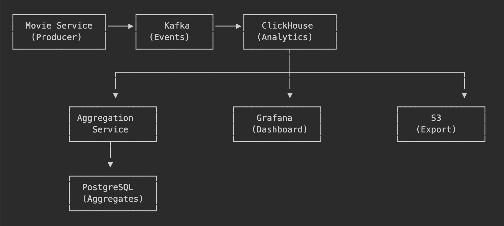
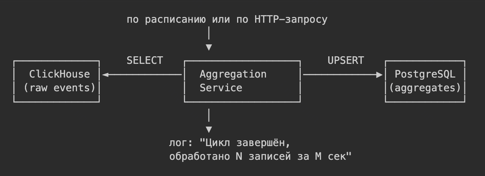

# Домашнее задание №5

## Online Cinema: Event Streaming + Analytics Pipeline

Спроектируйте и реализуйте **pipeline обработки событий** для аналитики онлайн-кинотеатра с использованием Kafka, ClickHouse и PostgreSQL.

Язык программирования и фреймворк — любые.

Задание разделено на **три блока по возрастанию сложности**:

- **1–4 балла** — базовая инфраструктура Kafka и ingestion pipeline
- **5–7 баллов** — агрегация данных и бизнес-метрики
- **8–10 баллов** — визуализация, экспорт и отказоустойчивость

Блоки оцениваются **последовательно**: если из блока 1–4 выполнены не все пункты, задания на 5–7 не оцениваются. Аналогично для 8–10.

---

## Архитектура системы

- **Movie Service (Producer)** — генерирует события о действиях пользователей (просмотр, лайк, поиск и т.д.), публикует их в Kafka topic `movie-events`.
- **Kafka** — брокер сообщений. Schema Registry используется для версионирования схем событий.
- **ClickHouse** — колоночная БД для хранения raw-событий и агрегации. Kafka Engine позволяет потреблять события напрямую из топика.
- **Aggregation Service** — отдельный сервис, который читает данные из ClickHouse, вычисляет бизнес-метрики (DAU, retention, конверсия) и пишет результаты в PostgreSQL.
- **Grafana** — дашборды для визуализации метрик.
- **S3** — долгосрочное хранилище для экспорта агрегатов.

> Все компоненты должны подниматься одной командой `docker-compose up`.

---

## Общие требования

- Всё поднимается через `docker-compose up` без дополнительных ручных шагов.
- Миграции БД применяются автоматически при старте.
- Схемы событий версионируются через Schema Registry (Avro или Protobuf).
- Тесты воспроизводимы и запускаются без ручных действий.

---

## 1–4 балла

### 1. Kafka topic со схемой событий (1 балл)

Спроектируйте схему события для Kafka topic `movie-events`.

**Обязательные поля:**

| Поле | Тип | Описание |
| --- | --- | --- |
| `event_id` | UUID | Уникальный идентификатор события |
| `user_id` | string | Идентификатор пользователя |
| `movie_id` | string | Идентификатор фильма |
| `event_type` | enum | `VIEW_STARTED`, `VIEW_FINISHED`, `VIEW_PAUSED`, `VIEW_RESUMED`, `LIKED`, `SEARCHED` |
| `timestamp` | datetime | Время события (UTC) |
| `device_type` | enum | `MOBILE`, `DESKTOP`, `TV`, `TABLET` |
| `session_id` | string | Идентификатор сессии |
| `progress_seconds` | integer | Прогресс просмотра в секундах (для событий просмотра) |

**Что нужно сделать:**

- Описать схему в **Avro** или **Protobuf**.
- Зарегистрировать схему в **Schema Registry** с указанием версии.
- Создать topic с минимум **3 партициями**.
- Выбрать **ключ партиционирования** (`user_id` или `movie_id`) и обосновать выбор.

---

### 2. Продюсер (1 балл)

Реализуйте микросервис, который принимает события и публикует их в Kafka. У сервиса две функции:

**HTTP API** — принимает события от внешних сервисов. Эндпоинт принимает событие в формате JSON, валидирует его и отправляет в Kafka. При ошибке валидации возвращает ошибку, при успешной отправке — идентификатор события.

**Генератор событий** — режим, в котором сервис самостоятельно генерирует поток синтетических событий, имитируя поведение пользователей (начал смотреть → пауза → продолжил → досмотрел, лайки, поиск). Нужен для наполнения pipeline данными и демонстрации работы системы. Генератор должен создавать реалистичные последовательности: например, `VIEW_STARTED` всегда предшествует `VIEW_FINISHED` в рамках одной сессии, `progress_seconds` растёт между событиями.

**Требования к Kafka-продюсеру:**

- Валидация события по схеме из п.1 перед отправкой.
- Ключ партиционирования для сохранения порядка событий одного пользователя/фильма.
- Подтверждение записи (`acks`).
- Обработка ошибок публикации (retry с exponential backoff).
- Логирование факта публикации (event_id, event_type, timestamp).

---

### 3. ClickHouse: приём и хранение событий (1 балл)

Спроектируйте схему данных в ClickHouse для приёма событий из Kafka и их хранения.

**Что нужно сделать:**

- Создать таблицу с движком **Kafka Engine**, которая читает из топика `movie-events`.
- Создать таблицу с движком **MergeTree** (или его вариацией) для постоянного хранения событий. Продумайте партиционирование и порядок сортировки под ваши будущие запросы.
- Настроить автоматическую перекладку данных из Kafka-таблицы в MergeTree (через **Materialized View** или `INSERT SELECT`).
- Убедиться, что схема ClickHouse соответствует схеме событий из п.1.

---

### 4. Интеграционный тест pipeline (1 балл)

Напишите тест, который проверяет весь путь события: от публикации в Kafka до появления в ClickHouse.

**Что нужно сделать:**

- Тест публикует событие через продюсер.
- Тест проверяет, что событие появилось в ClickHouse с корректными полями.
- Тест можно запускать многократно (данные очищаются или изолируются).
- Тест запускается одной командой, без ручных шагов.

---

## 5–7 баллов

### 5. Сервис агрегации с бизнес-метриками и выгрузкой в PostgreSQL (3 балла)

За этот блок можно получить либо все 3 балла, либо 0 — частичное выполнение не оценивается.

Реализуйте отдельный микросервис, который читает raw-события из ClickHouse, вычисляет бизнес-метрики и сохраняет результаты в PostgreSQL.

#### Сам сервис

- Работает в отдельном контейнере, не связан с продюсером или ingestion pipeline.
- Читает raw-события напрямую из ClickHouse (не из Kafka).
- Запускает вычисление агрегатов **по расписанию** (cron/scheduler). Интервал — на ваш выбор, но он должен быть настраиваемым (через переменную окружения или конфиг).
- Предоставляет HTTP-эндпоинт для **ручного запуска** пересчёта за конкретную дату, чтобы не ждать расписания.
- Логирует начало и завершение каждого цикла вычислений: сколько записей обработано, сколько времени заняло.

#### Бизнес-метрики

Сервис должен вычислять следующие агрегаты:

| Метрика | Что считаем |
| --- | --- |
| **DAU** | Количество уникальных пользователей за день |
| **Среднее время просмотра** | Средний `progress_seconds` для завершённых просмотров (`VIEW_FINISHED`) |
| **Топ фильмов** | Рейтинг фильмов по количеству просмотров |
| **Конверсия просмотра** | Доля `VIEW_FINISHED` от `VIEW_STARTED` |
| **Retention D1, D7** | Доля пользователей, вернувшихся через 1 и 7 дней после первого просмотра |

Требования к запросам:

- Использовать агрегатные или оконные функции ClickHouse (`uniq`, `avg`, `sum` и т.д.). Простого `count(*)` недостаточно.
- Агрегаты вычисляются за день (минимальная гранулярность). Можно добавить неделю/месяц.
- Результаты материализованы в ClickHouse (отдельные таблицы или materialized views). Схему хранения спроектируйте самостоятельно.

#### Выгрузка в PostgreSQL

После каждого цикла вычислений сервис сохраняет результаты в PostgreSQL. PostgreSQL здесь — хранилище «готовых» метрик, из которого их могут читать другие сервисы, дашборды или экспорт в S3.

- Спроектируйте схему PostgreSQL для хранения агрегатов. Как минимум должны быть: дата, название метрики, значение, время вычисления.
- Запись должна быть **идемпотентной** — повторный пересчёт за ту же дату обновляет значения, а не дублирует строки.
- Ошибки записи обрабатываются (retry, логирование).

#### Как это работает вместе

---

## 8–10 баллов

### 6. Grafana-дашборд (1 балл)

Подключите Grafana к ClickHouse и постройте аналитический дашборд.

**Базовые требования:**

- Grafana поднимается через `docker-compose`.
- Настроен datasource для ClickHouse.
- Дашборд использует агрегаты из п.5 (не raw-события).

**Обязательная панель — Retention Cohort Heatmap:**

Постройте таблицу когортного анализа retention. По вертикали — когорты пользователей по дате первого просмотра (день первой активности). По горизонтали — день жизни (Day 0, Day 1, Day 2, ... Day 7). В ячейках — процент пользователей когорты, вернувшихся в соответствующий день.

Пример того, как это должно выглядеть:

| Когорта    | Day 0 | Day 1 | Day 2 | Day 3 | ... | Day 7 |
| --- | --- | --- | --- | --- | --- | --- |
| 2026-04-01 | 100%  | 45%   | 32%   | 28%   | ... | 15%   |
| 2026-04-02 | 100%  | 42%   | 30%   | ...   | ... | ...   |

Эта панель требует нетривиального запроса в ClickHouse: нужно определить дату первого события для каждого пользователя, сгруппировать пользователей по когортам и посчитать возвращаемость по дням.

**Дополнительные панели (минимум 2 на ваш выбор):** DAU, конверсия, топ фильмов, распределение по устройствам, среднее время просмотра или что-то ещё из ваших агрегатов.

---

### 7. Экспорт в S3 (1 балл)

Реализуйте ежедневную выгрузку агрегатов из PostgreSQL в объектное хранилище. S3 выступает как «холодное» хранилище — итоговые метрики за прошедший день складываются туда для долгосрочного хранения и анализа вне основного pipeline.

**Что нужно сделать:**

- S3-совместимое хранилище (MinIO или аналог) поднимается в `docker-compose`.
- Сервис экспорта читает агрегаты из PostgreSQL за указанную дату и формирует файл.
- Формат файла: **CSV**, **JSON** или **Parquet** — на ваш выбор, но внутри файла должны быть все метрики за день (DAU, конверсия, retention и т.д.) с указанием даты и времени вычисления.
- Файлы складываются в бакет с партиционированием по дате: `s3://movie-analytics/daily/YYYY-MM-DD/aggregates.{format}`.
- Экспорт запускается автоматически (по расписанию в сервисе агрегации или отдельным job'ом) и может быть вызван вручную для конкретной даты.
- Повторный экспорт за ту же дату **перезаписывает** файл (а не создаёт дубликат).
- Обработка ошибок: если PostgreSQL или S3 недоступен, ошибка логируется и retry выполняется при следующем запуске.

---

### 8. Отказоустойчивая инфраструктура Kafka (1 балл)

Поднимите кластер Kafka с репликацией.

**Что нужно сделать:**

- Минимум **2 брокера** Kafka в `docker-compose`.
- Topic создан с `replication.factor >= 2` и `min.insync.replicas >= 1`.
- Поднят **Schema Registry**.
- Для всех компонентов настроены **health checks**.

---

**Дедлайн:** 25 ноября в 23:50.

**Закрытие практики:** 25 ноября в 23:59.
