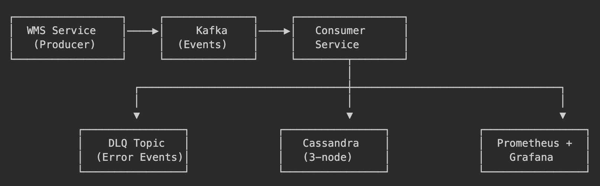

# Домашнее задание №6

## Smart Warehouse: Event-Driven State Management with Cassandra

Цель задания — спроектировать и реализовать **event-driven систему управления складом** с использованием Kafka и Cassandra. Система должна обрабатывать поток событий о перемещениях товаров, поддерживать актуальное состояние склада и обеспечивать устойчивость к сбоям.

Задание можно реализовывать на любом языке программирования и любом фреймворке.

Задание разделено на **три блока по возрастанию сложности**:

- **1-4 балла** — stateful consumer + корректная модель данных
- **5-7 баллов** — устойчивость обработки событий
- **8-10 баллов** — кластер, мониторинг и эволюция

Блоки оцениваются **последовательно**: пункты следующего блока проверяются только при полном выполнении предыдущего. Например, если из блока 1-4 выполнены только 3 пункта из 4, задания на 5-7 баллов не оцениваются.

---

## Архитектура системы



**WMS Service (Producer)** - генерирует события о складских операциях (приёмка, отгрузка, перемещение, инвентаризация). Публикует события в Kafka topic `warehouse-events`.

**Kafka** - брокер сообщений для надёжной доставки событий. Используется Schema Registry для версионирования схем.

**Consumer Service** - сервис-потребитель, который читает события из Kafka, обрабатывает их и обновляет состояние в Cassandra.

**Cassandra (3-node cluster)** - распределённая БД для хранения текущего состояния склада (остатки товаров, местоположения, статусы заказов). В блоке 8-10 разворачивается как кластер из 3 нод.

**DLQ Topic** - отдельный Kafka topic для проблемных событий, которые не удалось обработать.

**Prometheus + Grafana** - мониторинг consumer-сервиса: метрики, дашборды, алерты (блок 8-10).

> Все компоненты поднимаются одной командой `docker-compose up`.

---

## Общие требования

- Все сервисы и инфраструктура поднимаются одной командой `docker-compose up`.
- Миграции БД (Cassandra) применяются автоматически при старте.
- Схемы событий (Avro/Protobuf) версионируются через Schema Registry.

---

## Предметная область

Система управляет складом с следующими сущностями:

**Товар (Product)** - уникальный товар с SKU (артикулом). Хранится в определённых зонах склада.

**Зона склада (Zone)** - физическое место хранения (стеллаж, полка, ячейка). Имеет идентификатор и вместимость.

**Остаток (Inventory)** - количество товара в конкретной зоне. Состоит из доступного количества и зарезервированного.

**Заказ (Order)** - заказ на отгрузку товаров. Содержит список позиций с количеством.

**События** - операции над складом:

- `PRODUCT_RECEIVED` - приёмка товара на склад
- `PRODUCT_SHIPPED` - отгрузка товара со склада
- `PRODUCT_MOVED` - перемещение товара между зонами
- `PRODUCT_RESERVED` - резервирование товара для заказа
- `PRODUCT_RELEASED` - снятие резерва с товара
- `INVENTORY_COUNTED` - пересчёт остатков (инвентаризация)
- `ORDER_CREATED` - создание заказа
- `ORDER_COMPLETED` - завершение заказа

---

## 1-4 балла

### 1. Kafka consumer с осмысленной семантикой (1 балл)

Необходимо реализовать сервис-потребитель, который читает события из Kafka topic `warehouse-events`.

**Требования:**

- Сервис читает события из Kafka topic `warehouse-events`.
- Используется **consumer group** с осмысленным именем (например, `warehouse-state-consumer`).
- Реализована **at-least-once семантика**: offset commit происходит **после** успешной обработки события и записи в Cassandra.
- Offset не коммитится «на авось» (не до обработки, не в произвольный момент).
- При рестарте сервиса обработка продолжается с последнего закоммиченного offset.
- В логах фиксируется факт обработки события (event_id, event_type, offset, partition).

---

### 2. Проектирование модели данных под Cassandra (1 балл)

Необходимо самостоятельно спроектировать схему данных в Cassandra для хранения состояния склада.

**Требования:**

- Таблицы спроектированы **под запросы**!
- Используются **partition key** и **clustering key** осознанно (обосновать выбор в README).
- Нет JOIN.
- Нет нормализации ради нормализации (допускается денормализация для эффективности запросов).
- Минимум 3 таблицы для разных сценариев доступа:
  - Остатки товаров по зонам
  - Остатки товаров в целом (агрегировано по всем зонам)
  - История событий (опционально, для аудита)

**Примерные запросы, которые должны поддерживаться:**

```sql
-- Получить остаток товара в конкретной зоне
SELECT * FROM inventory_by_product_zone WHERE product_id = ? AND zone_id = ?;

-- Получить все остатки товара по всем зонам
SELECT * FROM inventory_by_product WHERE product_id = ?;

-- Получить все товары в зоне
SELECT * FROM inventory_by_zone WHERE zone_id = ?;
```

---

### 3. Обработка событий с записью состояния (1 балл)

Необходимо реализовать обработку событий, которая приводит к изменению состояния в Cassandra.

**Требования:**

- Каждое событие приводит к **изменению состояния** (обновлению остатков, резервов и т.д.).
- Запись идёт в Cassandra.
- Нет потери данных при рестарте сервиса (состояние сохраняется в Cassandra).
- Обработка событий **детерминирована**: одно и то же событие приводит к одинаковому изменению состояния.

**Примеры обработки событий:**

| Событие | Изменение состояния |
|----|----|
| `PRODUCT_RECEIVED` | `available_quantity += quantity` в зоне |
| `PRODUCT_SHIPPED` | `available_quantity -= quantity` в зоне |
| `PRODUCT_MOVED` | `available_quantity -= quantity` в зоне A, `+= quantity` в зоне B |
| `PRODUCT_RESERVED` | `available_quantity -= quantity`, `reserved_quantity += quantity` |
| `PRODUCT_RELEASED` | `reserved_quantity -= quantity`, `available_quantity += quantity` |
| `INVENTORY_COUNTED` | установить `available_quantity = counted_quantity` |
| `ORDER_CREATED` | создание записи заказа со статусом `CREATED`, резервирование товаров по позициям (аналогично `PRODUCT_RESERVED` для каждой позиции) |
| `ORDER_COMPLETED` | перевод заказа в статус `COMPLETED`, отгрузка зарезервированных товаров (`reserved_quantity -= quantity`, `available_quantity` не меняется — товар уже был вычтен из available при резервировании) |

---

### 4. Идемпотентная обработка событий (1 балл)

Необходимо обеспечить базовую идемпотентность: повторная обработка одного и того же события не должна ломать состояние.

**Требования:**

- Повторное событие **не ломает** состояние (не создаёт дубликатов, не удваивает количество).
- Реализован механизм **отслеживания обработанных событий**: перед обработкой consumer проверяет, было ли событие уже обработано (по `event_id`), и пропускает дубликаты.
- Дубли из Kafka (at-least-once delivery) **не приводят к дублированию** изменений.

---

## 5-7 баллов

### 5. Консистентность между денормализованными таблицами (1 балл)

Одно событие должно **атомарно обновлять все связанные таблицы** в Cassandra.

> **Отличие от пункта 3:** в пункте 3 достаточно обработать событие и записать изменение хотя бы в одну таблицу. Здесь требуется, чтобы при обработке одного события все денормализованные таблицы обновлялись **консистентно** — например, `PRODUCT_RECEIVED` обновляет и `inventory_by_product_zone`, и `inventory_by_product`, и `inventory_by_zone` в одной операции.

**Требования:**

- Одно событие обновляет **все связанные таблицы** (например, `inventory_by_product_zone`, `inventory_by_product`, `inventory_by_zone`).
- Используется **Cassandra BATCH** (logged batch) для атомарного обновления нескольких таблиц в рамках одного события.
- Не бывает ситуации, когда `inventory_by_zone` обновилась, а `inventory_by_product` — нет (частичное обновление).

---

### 6. Корректная обработка событий вне порядка (1 балл)

Сервис не должен ломаться, если события приходят **не по порядку**.

**Требования:**

- Сервис **не ломается**, если события приходят в неправильном порядке.
- Используется один из подходов:
  - **Версия сущности** - каждое событие содержит version сущности, старые события игнорируются
  - **Номер события** - каждое событие содержит sequence_number, обрабатываются только новее
  - **Timestamp с проверкой** - событие обрабатывается, только если его timestamp новее последнего обработанного
- **Старые события не затирают** более новое состояние.

**Пример:**

```text
Событие 1: PRODUCT_RECEIVED, quantity=100, timestamp=12:00:00
Событие 2: PRODUCT_SHIPPED, quantity=20, timestamp=12:05:00
Событие 3: PRODUCT_RECEIVED, quantity=50, timestamp=12:02:00 (пришло позже, но старше События 2)

Правильное поведение:
- Событие 1: available = 100
- Событие 2: available = 80
- Событие 3: ИГНОРИРУЕТСЯ (timestamp 12:02:00 < последнего обработанного 12:05:00)
```

---

### 7. Dead Letter Queue для проблемных событий (1 балл)

При ошибке обработки событие должно отправляться в **Dead Letter Queue (DLQ)**.

**Требования:**

- При ошибке обработки событие **не блокирует** consumer (не падает цикл обработки).
- Событие отправляется в отдельный Kafka topic `warehouse-events-dlq`.
- В DLQ сохраняется:
  - **Исходное событие** (полностью, со всеми полями)
  - **Причина ошибки** (текст ошибки, код, стекtrace опционально)
  - **Метаданные** (timestamp ошибки, partition, offset)
- Реализован сценарий, где событие **гарантированно улетает в DLQ** (например, невалидное событие).

**Пример структуры DLQ:**

```json
{
  "original_event": { ... исходное событие ... },
  "error_reason": "Invalid quantity: -5 (must be positive)",
  "error_code": "VALIDATION_ERROR",
  "failed_at": "2026-04-01T12:00:00Z",
  "kafka_metadata": {
    "partition": 2,
    "offset": 12345
  }
}
```

---

## 8-10 баллов

### 8. Cassandra Multi-Node Cluster (1 балл)

Необходимо развернуть **кластер Cassandra из 3 нод** и продемонстрировать отказоустойчивость и понимание consistency levels.

**Требования:**

- В `docker-compose.yml` описаны **3 ноды Cassandra** (`cassandra-1`, `cassandra-2`, `cassandra-3`), объединённые в один кластер.
- Keyspace создаётся с `NetworkTopologyStrategy` и `replication_factor = 3`.
- Consumer использует **осознанные consistency levels**:
  - Для записей — `QUORUM` (гарантия, что данные записаны на большинство нод).
  - Для чтений — студент выбирает `ONE` или `QUORUM` и **обосновывает выбор** в README (trade-off между скоростью и консистентностью).
- Продемонстрирована **отказоустойчивость**: при остановке одной ноды (`docker stop cassandra-2`) система продолжает принимать и обрабатывать события без ошибок.

---

### 9. Monitoring + Consumer Lag (1 балл)

Необходимо реализовать **мониторинг** consumer-сервиса: метрики, health-проверки, визуализация в Grafana.

**Требования:**

**Prometheus-совместимый endpoint** `/metrics` с метриками:

- `consumer_lag` — отставание consumer от HEAD топика (разница между latest offset и committed offset). Gauge, по партициям.
- `events_processed_total` — счётчик обработанных событий (label: `event_type`). Counter.
- `event_processing_duration_seconds` — время обработки одного события. Histogram.
- `cassandra_write_errors_total` — количество ошибок при записи в Cassandra. Counter.

**Health endpoint** `/health` для liveness/readiness проб:

- Возвращает `200 OK` если consumer подключён к Kafka и Cassandra доступна.
- Возвращает `503 Service Unavailable` если одно из подключений потеряно.

**Grafana dashboard:**

- В `docker-compose.yml` поднимается **Prometheus** (scrape consumer `/metrics`) и **Grafana**.
- Создан dashboard с **минимум 3 панелями**:
  - Consumer lag по партициям
  - Throughput — events processed per second
  - Ошибки записи в Cassandra

---

### 10. Schema Evolution (1 балл)

Необходимо **реализовать** поддержку двух версий одного типа события и продемонстрировать, что consumer обрабатывает обе версии одновременно.

**Задание (по шагам):**

1.  Зарегистрировать в **Schema Registry** исходную Avro-схему для одного из событий (например, `ProductReceived`).
2.  Создать **вторую версию схемы** с дополнительным полем (например, `supplier_id`). Новое поле должно иметь значение по умолчанию (`null`) для backward compatibility.
3.  Зарегистрировать V2-схему в Schema Registry с проверкой совместимости (backward).
4.  Реализовать в consumer **обработку обеих версий**: V1-события (без нового поля) и V2-события (с новым полем) приходят **в одном топике** и обрабатываются без ошибок.
5.  Для V2 — новое поле записывается в Cassandra (добавить колонку). Для V1 — колонка получает значение по умолчанию (`null`).
6.  Документировать в README: какая стратегия совместимости используется и **пошаговая инструкция** по добавлению новой версии события.

**Требования:**

- Версионирование реализовано через **Schema Registry** (Avro + backward compatibility).
- Consumer содержит **явную логику** обработки разных версий.
- Старые события (V1) **продолжают обрабатываться** без ошибок после добавления V2.

**Пример: Avro schema evolution (backward compatible)**

```json
{
  "type": "record",
  "name": "ProductReceived",
  "fields": [
    {"name": "product_id", "type": "string"},
    {"name": "quantity", "type": "int"},
    {"name": "zone_id", "type": "string"},
    {"name": "supplier_id", "type": ["null", "string"], "default": null}
  ]
}
```

---

## E2E-сценарии для проверки

Студент должен уметь воспроизвести каждый сценарий, соответствующий набранным баллам.

### Сценарий 1: Базовый цикл склада (пункты 1-3)

```text
1. docker-compose up — система поднимается, consumer подключается к Kafka
2. Отправить PRODUCT_RECEIVED: product=SKU-001, zone=ZONE-A, quantity=100
3. Проверить в Cassandra: inventory_by_product_zone → available=100 в ZONE-A
4. Проверить в Cassandra: inventory_by_product → total_available=100
5. Отправить PRODUCT_RESERVED: product=SKU-001, zone=ZONE-A, quantity=30
6. Проверить: available=70, reserved=30
7. Отправить PRODUCT_MOVED: product=SKU-001, from=ZONE-A, to=ZONE-B, quantity=20
8. Проверить: ZONE-A available=50, ZONE-B available=20
9. Отправить PRODUCT_SHIPPED: product=SKU-001, zone=ZONE-A, quantity=10
10. Проверить: ZONE-A available=40
11. Отправить ORDER_CREATED с позицией SKU-001, quantity=15
12. Проверить: reserved увеличился на 15
13. Отправить ORDER_COMPLETED для этого заказа
14. Проверить: reserved уменьшился на 15
```

### Сценарий 2: Идемпотентность (пункт 4)

```text
1. Отправить PRODUCT_RECEIVED: product=SKU-002, zone=ZONE-A, quantity=50
2. Проверить: available=50
3. Повторно отправить то же самое событие (тот же event_id)
4. Проверить: available по-прежнему 50 (не 100)
```

### Сценарий 3: Консистентность таблиц (пункт 5)

```text
1. Отправить PRODUCT_RECEIVED: product=SKU-003, zone=ZONE-A, quantity=100
2. Проверить три таблицы:
   - inventory_by_product_zone: product=SKU-003, zone=ZONE-A → available=100
   - inventory_by_product: product=SKU-003 → total_available=100
   - inventory_by_zone: zone=ZONE-A → содержит SKU-003, available=100
3. Все три таблицы содержат согласованные данные
```

### Сценарий 4: События вне порядка (пункт 6)

```text
1. Отправить PRODUCT_RECEIVED: product=SKU-004, zone=ZONE-A, quantity=100, timestamp=12:00
2. Отправить PRODUCT_SHIPPED: product=SKU-004, zone=ZONE-A, quantity=20, timestamp=12:05
3. Проверить: available=80
4. Отправить PRODUCT_RECEIVED: product=SKU-004, zone=ZONE-A, quantity=50, timestamp=12:02
   (событие старше, чем последнее обработанное)
5. Проверить: available по-прежнему 80 (событие проигнорировано)
```

### Сценарий 5: Dead Letter Queue (пункт 7)

```text
1. Отправить невалидное событие: PRODUCT_SHIPPED с quantity=-5
2. Проверить: consumer не упал, продолжает работать
3. Проверить topic warehouse-events-dlq: содержит событие с причиной ошибки
4. Отправить валидное событие после невалидного
5. Проверить: валидное событие обработано корректно
```

### Сценарий 6: Cassandra cluster и отказоустойчивость (пункт 8)

```text
1. docker-compose up — поднимается кластер из 3 нод Cassandra
2. Выполнить: docker exec cassandra-1 nodetool status → видны 3 ноды в статусе UN
3. Отправить PRODUCT_RECEIVED: product=SKU-006, zone=ZONE-A, quantity=200
4. Проверить: данные записаны корректно
5. Остановить одну ноду: docker stop cassandra-2
6. Отправить PRODUCT_SHIPPED: product=SKU-006, zone=ZONE-A, quantity=50
7. Проверить: событие обработано, available=150 (система работает без ноды)
8. Запустить ноду обратно: docker start cassandra-2
9. Проверить: нода присоединилась к кластеру (nodetool status → 3 ноды UN)
10. Студент демонстрирует разницу CL=ONE vs CL=QUORUM vs CL=ALL при убитой ноде
```

### Сценарий 7: Мониторинг и consumer lag (пункт 9)

```text
1. Открыть http://localhost:<port>/health → 200 OK
2. Открыть http://localhost:<port>/metrics → видны метрики в Prometheus-формате
3. Отправить 10 событий разных типов
4. Проверить /metrics: events_processed_total увеличился, consumer_lag отображается
5. Открыть Grafana (http://localhost:3000) → dashboard с панелями (lag, throughput, errors)
6. Остановить consumer → consumer_lag растёт
7. Проверить: алерт на consumer lag срабатывает (lag > порога)
8. Запустить consumer обратно → lag уменьшается
```

### Сценарий 8: Schema Evolution (пункт 10)

```text
1. Отправить событие V1: PRODUCT_RECEIVED (product_id, quantity, zone_id)
2. Проверить: событие обработано, данные в Cassandra корректны
3. Отправить событие V2: PRODUCT_RECEIVED (product_id, quantity, zone_id, supplier_id="SUP-001")
4. Проверить: событие обработано, supplier_id записан в Cassandra
5. Проверить V1-запись: supplier_id = null (значение по умолчанию)
6. Проверить V2-запись: supplier_id = "SUP-001"
7. Студент показывает в Schema Registry обе версии схемы
```

---

**Дедлайн:** 3 декабря в 23:59.

**Закрытие практики:** 3 декабря в 23:59.
